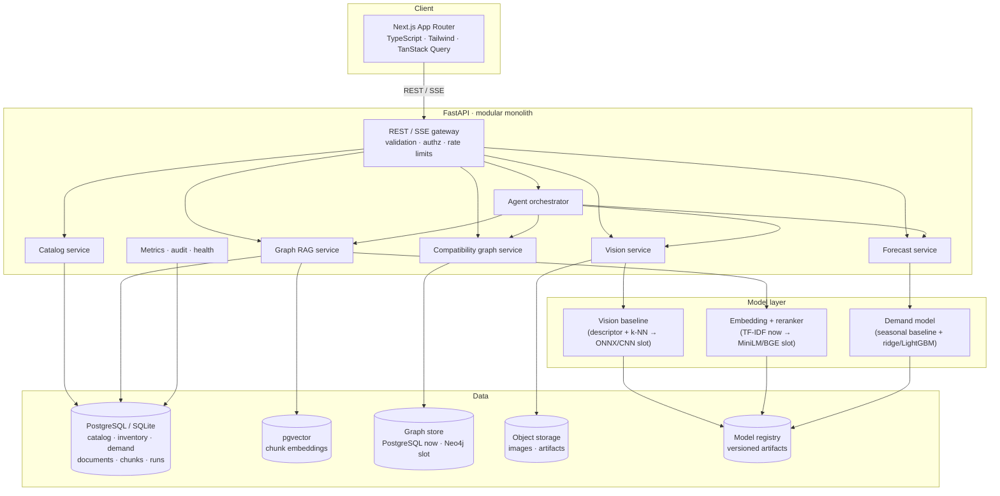
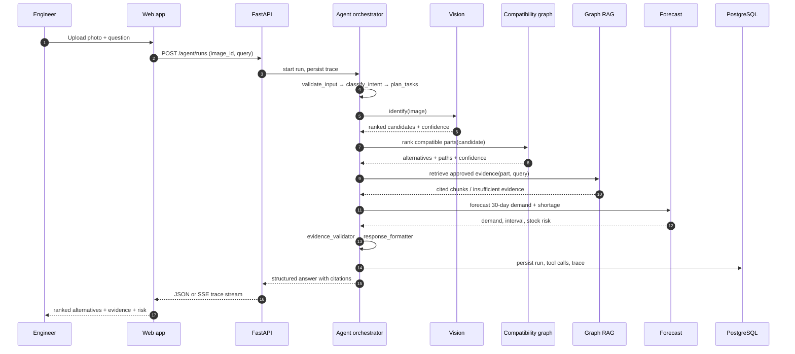

# PartScope — Industrial Parts Intelligence Platform

**Identify a part from a photo or a description, find compatible alternatives, ground every answer in approved documentation, and predict next month's stock risk — in one traceable request.**

<p>
  
  
  
  
  
  
  
</p>

---

## Table of contents

1. [Why this exists](#why-this-exists)
2. [What the platform does](#what-the-platform-does)
3. [The flagship request](#the-flagship-request)
4. [Architecture](#architecture)
5. [Request lifecycle](#request-lifecycle)
6. [Design decisions and trade-offs](#design-decisions-and-trade-offs)
7. [Feature matrix](#feature-matrix)
8. [Technology stack](#technology-stack)
9. [Repository layout](#repository-layout)
10. [Quickstart](#quickstart)
11. [API surface](#api-surface)
12. [Evaluation methodology](#evaluation-methodology)
13. [Model lifecycle and MLOps](#model-lifecycle-and-mlops)
14. [Security and governance](#security-and-governance)
15. [Deployment](#deployment)
16. [Demo dataset](#demo-dataset)
17. [Project status](#project-status)
18. [Roadmap](#roadmap)

---

## Why this exists

Industrial spare-parts operations are an evidence problem disguised as a search problem.

A maintenance engineer holding a worn component has to answer several questions at once:

- **What is this part?** The label is gone, the manual is a PDF, and the part number is a stamped string that looks like twelve others.
- **What actually fits?** Catalogues list "compatible" parts with no proof. Interchangeability depends on bore, thread, pressure class, mounting pattern and equipment variant.
- **What does the documentation say?** The answer is buried across service manuals, compatibility bulletins and maintenance guides that disagree with each other.
- **Will it be available?** Ordering the wrong alternative, or the right one with no stock, still stops the machine.
- **Can I defend the decision?** Procurement and safety teams need a source, a confidence level and an audit trail — not a chat response.

General-purpose LLM chat interfaces are a poor fit. They confidently invent compatibility, cannot prove stock, and cannot show which document supported a claim. **PartScope is built around the opposite principle: deterministic evidence first, generated language last — or not at all.**

The platform combines five capabilities behind one API and one workflow:

| Capability | Question answered | Evidence returned |
|---|---|---|
| Catalog intelligence | *What is this part?* | Canonical part record, specs, provenance |
| Vision identification | *Which part is in this photo?* | Ranked candidates + confidence |
| Compatibility graph | *What else fits?* | Relationship path, source, confidence |
| Grounded retrieval | *What do the documents say?* | Chunk-level citations, refusal when unsupported |
| Demand forecasting | *Will it be in stock?* | 30-day demand, interval, shortage probability |

An agent orchestrator composes them into a single request, and every step is persisted as a traceable run.

---

## What the platform does

- **Catalog search** across part numbers, names, descriptions, categories, manufacturers and technical specifications, with fuzzy part-number matching and stock-aware filters.
- **Image-based identification** with upload validation, deterministic preprocessing, top-N candidates, category aggregation, confidence scoring and a low-confidence review path.
- **Compatibility reasoning** over a directed relationship graph (`COMPATIBLE_WITH`, `REPLACES`, `SUPERSEDES`, `USED_IN`) with weighted traversal, confidence and explainable paths.
- **Graph-aware retrieval (Graph RAG)** that links query entities to catalog records and document chunks, re-ranks by entity overlap and graph proximity, and returns citations or an explicit *insufficient evidence* result.
- **Demand and shortage forecasting** with a seasonal baseline and a learned tabular model, time-based validation, prediction intervals and reorder suggestions.
- **Agent orchestration** with typed tools, conditional routing, bounded retries, persisted tool runs and human-readable trace events.
- **Model lifecycle** with registered model versions, metrics, dataset hashes, approval state and artifact metadata.
- **Operational visibility** through health endpoints, Prometheus metrics, structured logs and an audit event stream.

---

## The flagship request

> *"Find compatible replacement parts for this forklift component, show the approved alternatives, and estimate whether each alternative will be in stock next month."*

The platform resolves this in one orchestrated run:

```text
POST /api/v1/agent/runs
{
  "query": "Find compatible replacement parts for this forklift hydraulic pump and tell me if they will be in stock next month",
  "image_id": "a3f1c9...",
  "include_forecast": true
}
```

The response contains, for each ranked alternative:

- part identity and specification match,
- the graph relationship and confidence that justify it,
- the document chunk and page that approve it,
- the 30-day demand estimate, interval, current stock and shortage probability,
- the model versions and data freshness used,
- explicit warnings where evidence is thin.

Every node, tool call, latency and failure is persisted so the run can be replayed and audited.

---

## Architecture



The architecture is deliberately a **modular monolith**. Routers are separated by domain and communicate through typed service interfaces, so any module can be split into its own deployment when scaling evidence justifies it. There is no premature Kubernetes or service mesh.

### Module boundaries

```text
apps/api/app/routers/   catalog · vision · compatibility · retrieval · forecast · agent · documents · admin · health
src/catalog/            search, filtering, fuzzy matching
src/vision/             descriptor, baseline model, synthetic renderer, service
src/graph/              relationship traversal and ranking
src/retrieval/          chunking, indexing, Graph RAG ranking, grounded answers
src/forecasting/        feature engineering, baselines, model, service
src/agents/             LangGraph workflow, typed tools, trace persistence
src/monitoring/         metrics and audit helpers
training/               reproducible training entry points
evaluation/             benchmark and faithfulness harnesses
```

### Storage strategy

| Concern | Development | Production |
|---|---|---|
| Operational data | SQLite (zero-setup) | PostgreSQL 16 |
| Vector search | In-process TF-IDF | pgvector (`vector` column + IVFFlat/HNSW) |
| Graph traversal | SQL adjacency with indexed edges | PostgreSQL now, Neo4j when traversal depth grows |
| Images / artifacts | Local filesystem | Google Cloud Storage or S3 |
| Experiment tracking | Local MLflow-compatible artifact layout | MLflow Tracking + Model Registry |

Provider-neutral interfaces mean the same application code runs locally and in a deployed environment. Swapping SQLite for PostgreSQL is a `DATABASE_URL` change; swapping the vision runner or embedding model is an adapter change.

---

## Request lifecycle



---

## Design decisions and trade-offs

| Decision | Why | Trade-off |
|---|---|---|
| **Deterministic evidence before generation** | Compatibility and stock claims must be defensible; an LLM must never invent them. | Less conversational flexibility; answers are structured and occasionally refuse. |
| **Baselines first (k-NN vision, TF-IDF retrieval, seasonal + ridge forecast)** | A measurable baseline beats an opaque model hidden behind a chat UI. Every later model must beat it on a fixed split. | Lower peak accuracy than a fine-tuned transformer until upgrade artifacts land. |
| **Modular monolith, not microservices** | One container deploys and debugs easily; domain boundaries stay clean. | Requires discipline to keep modules decoupled. |
| **PostgreSQL as the source of truth; graph as an abstraction** | Relational integrity for catalog/inventory; graph traversal is indexed adjacency until Neo4j is justified. | Deep multi-hop traversal is slower than a native graph database at very large scale. |
| **SQLite default for local development** | `git clone` → working stack with no Docker or database install. | SQLite-specific pragmas; CI also runs PostgreSQL for parity. |
| **Synthetic, labelled demo dataset** | The repository must run end-to-end without licensing or privacy issues. | Model metrics on synthetic renders are not production accuracy claims; real data must be ingested and re-evaluated. |
| **Explicit uncertainty everywhere** | Confidence, intervals, low-confidence review and refusal are first-class fields. | More verbose API contracts. |
| **Immutable model versions and artifact metadata** | Reproducibility and rollback; preprocessing and label maps travel with the model. | Artifact storage and registry discipline required. |

---

## Feature matrix

| Area | Implemented in this repository |
|---|---|
| Catalog search | Full-text + fuzzy part-number search, spec filters, price/stock filters, pagination |
| Catalog governance | Canonical part numbers, supersession links, source provenance, soft-delete-ready schema |
| Vision upload | MIME/size/dimension validation, hashing, deterministic preprocessing |
| Vision inference | Top-N candidates, category aggregation, confidence, review flag, latency reporting |
| Similar-image search | Embedding nearest-neighbour retrieval |
| Compatibility graph | Directed relationships, weighted traversal, explainable paths, verification endpoint |
| Document ingestion | Chunking, section/page metadata, approval state, indexing endpoint |
| Retrieval | Hybrid lexical + entity + graph re-ranking, citations, refusal on weak evidence |
| Forecasting | Seasonal baseline, learned tabular model, time-based splits, intervals, shortage probability, reorder quantity |
| Agent | LangGraph state machine, typed tools, retries/timeouts, persisted runs, SSE trace |
| MLOps | Versioned artifacts, metrics, dataset hash, approval flag, registry view |
| Observability | Prometheus metrics, structured JSON logs, request IDs, audit events |
| Frontend | Search, part detail, identify, chat, forecast, documents, model/import/audit admin |
| Tests | Unit, API, model-contract, integration and end-to-end tests |

---

## Technology stack

**Backend** — Python 3.11, FastAPI, Pydantic v2, SQLAlchemy 2, Alembic, structlog, Tenacity, HTTPX, Prometheus client.

**AI/ML** — NumPy, Pillow, scikit-learn, joblib, LangGraph/LangChain core. The model layer is adapter-based: the CPU descriptor + k-NN vision baseline, TF-IDF retrieval baseline and ridge/seasonal forecasting baseline are production-quality reference implementations that can be replaced by ONNX Runtime, OpenVINO, TensorRT, `timm`, HuggingFace Transformers or LightGBM without changing the API.

**Data** — SQLite locally, PostgreSQL 16 + pgvector in deployment, filesystem object storage locally, GCS/S3 in deployment.

**Frontend** — Next.js 14 App Router, TypeScript, Tailwind CSS, shadcn-style primitives, TanStack Query, Zod.

**Ops** — Docker Compose, GitHub Actions, MLflow-compatible artifact registry, OpenTelemetry-ready tracing, Prometheus/Grafana or Cloud Monitoring.

---

## Repository layout

```text
partscope/
├── apps/
│   ├── api/                 FastAPI application and routers
│   └── web/                 Next.js application
├── src/
│   ├── catalog/             search and filtering
│   ├── vision/              descriptor, baseline model, synthetic renderer
│   ├── graph/               compatibility traversal
│   ├── retrieval/           indexing, Graph RAG, grounded answers
│   ├── forecasting/         features, baselines, service
│   ├── agents/              LangGraph workflow and tools
│   ├── monitoring/          metrics and audit
│   ├── models/              SQLAlchemy models
│   ├── schemas/             Pydantic contracts
│   ├── seed/                deterministic demo-data generator
│   └── common/              config, db, logging, utilities
├── training/                reproducible training entry points
├── evaluation/              benchmark harnesses and reports
├── scripts/                 seed and maintenance scripts
├── tests/                   unit, API, model and integration tests
├── infra/                   Dockerfiles, Compose, deployment notes
├── docs/                    architecture, API, model cards, runbook
├── Makefile
├── pyproject.toml
└── README.md
```

---

## Quickstart

### Prerequisites

- Python 3.11+
- Node.js 20+
- `uv` (recommended) or pip
- Docker (optional, for the containerised stack)

### 1. Backend

```bash
git clone https://github.com/<owner>/partscope.git
cd partscope

uv venv --python 3.11
# Windows: .venv\Scripts\activate
# macOS/Linux: source .venv/bin/activate

uv pip install -r requirements-dev.txt

# Generate the deterministic demo dataset and synthetic part renders
python -m scripts.seed

# Train the vision baseline and forecast model, writing versioned artifacts
python -m training.vision.train
python -m training.forecasting.train

# Run the API
python -m uvicorn app.main:app --app-dir apps/api --reload --port 8000
```

OpenAPI docs: <http://localhost:8000/docs>

### 2. Frontend

```bash
cd apps/web
npm install
npm run dev
```

App: <http://localhost:3000>

### 3. One command with Docker Compose

```bash
docker compose up --build
```

This starts PostgreSQL, the API, the web app and a seeded database.

---

## API surface

All endpoints are versioned under `/api/v1`.

| Domain | Endpoints |
|---|---|
| Catalog | `GET /parts`, `GET /parts/{id}`, `POST /parts/search`, `POST /parts/import`, `PATCH /parts/{id}` |
| Vision | `POST /vision/upload`, `POST /vision/identify`, `POST /vision/similar`, `POST /vision/evaluate` |
| Compatibility | `GET /parts/{id}/compatibilities`, `POST /compatibility/rank`, `POST /compatibility/verify` |
| Retrieval | `POST /retrieval/search`, `POST /retrieval/answer`, `POST /documents/index` |
| Forecasting | `POST /forecast/demand`, `GET /forecast/parts/{id}`, `POST /forecast/evaluate` |
| Agent | `POST /agent/runs`, `GET /agent/runs/{run_id}`, `GET /agent/runs/{run_id}/events`, `POST /agent/runs/{run_id}/feedback`, `POST /agent/runs/{run_id}/cancel` |
| Admin | `GET /admin/models`, `GET /admin/audit`, `GET /admin/imports` |
| System | `GET /health/live`, `GET /health/ready`, `GET /metrics` |

Every response that depends on catalog, document or forecast data includes the model version, data freshness and a synthetic-data flag for the bundled dataset.

---

## Evaluation methodology

Evaluation is treated as a product feature, not an afterthought. Each capability has a fixed, versioned evaluation set and a documented baseline.

| Capability | Metrics | Baseline to beat |
|---|---|---|
| Vision classification | Top-1, Top-5, macro/weighted F1, per-class recall, P50/P95 latency | Descriptor + k-NN |
| Similar-image retrieval | Recall@1, Recall@5, MRR | Random / popularity |
| Retrieval | Recall@k, MRR, NDCG | Lexical-only TF-IDF |
| Answer faithfulness | Citation validity, grounded-answer rate, refusal correctness | Retrieval-only formatting |
| Compatibility ranking | Precision@k, recall, explainable-path coverage | Popularity baseline |
| Forecasting | MAE, RMSE, MAPE, interval coverage, calibration | Seasonal naive |

Forecasting uses **time-based splits only** — never a random split over time-series data. Vision and retrieval splits are grouped by part so the same part cannot leak across train and test. Reports are written to `evaluation/reports/` and summarised in `docs/model-cards/`.

---

## Model lifecycle and MLOps

Every training run records:

- dataset URI, version and hash,
- code commit and dependency lock,
- random seed and hyperparameters,
- split methodology,
- training/validation metrics,
- artifact path and preprocessing configuration,
- label map and model card,
- approval status.

Promotion is gated: train → evaluate → register → contract test → staging comparison → manual approval → monitor for drift → roll back to the previous version if a regression is detected.

Artifacts are immutable and versioned:

```text
artifacts/
├── vision/baseline/
│   ├── embeddings.npz
│   └── metadata.json        # version, image size, descriptor dim, metrics, notes
└── forecasting/
    ├── model.joblib
    └── metadata.json        # features, metrics, dataset hash, split dates
```

---

## Security and governance

- Role-based access control on all mutation, upload and agent endpoints (deployment mode).
- Upload validation: content type, size, image decode, hashing; malware scanning hook in deployment.
- Secrets injected via environment or a secret manager — never committed.
- Request IDs, actor, model version, data source and decision outcome written to the audit stream.
- Sensitive fields redacted from logs.
- Compatibility recommendations require an approved source; unsupported claims are refused.
- Retention and deletion rules for conversations, uploads and runs.
- Encryption in transit and at rest in deployment.

---

## Deployment

The default target is a single stateless API container plus a managed PostgreSQL instance:

```bash
# Build and run locally
docker compose up --build

# Production outline
# 1. Push images to Artifact Registry / GHCR
# 2. Provision Cloud SQL (PostgreSQL + pgvector) or equivalent
# 3. Run Alembic migrations
# 4. Deploy API to Cloud Run / ECS / Fly.io
# 5. Deploy web app to Vercel / Cloud Run
# 6. Configure GCS/S3 for images and artifacts
# 7. Enable Cloud Monitoring + Error Reporting
```

Kubernetes, GPU autoscaling and a dedicated graph database are intentionally deferred until load and traversal evidence justifies them. See `docs/runbook.md` for operational procedures.

---

## Demo dataset

The repository ships with a **deterministic, generated demo dataset** so the full stack runs on a fresh clone with no external services:

- 600 parts across 15 categories, 40 manufacturers, 15 equipment models,
- technical specifications, suppliers and lead times,
- compatibility and supersession relationships,
- 18 months of daily demand history,
- 12 months of inventory snapshots across three warehouses,
- 60 documents with chunked, page-referenced text,
- 600 procedurally rendered part images.

All demo records are flagged as generated. Metrics produced against this dataset validate the pipeline and the evaluation harness — they are not claims about accuracy on a real industrial catalog. Point `DATABASE_URL` at PostgreSQL, ingest your own catalog and documents, and re-run `training/` and `evaluation/` to produce production metrics.

---

## Project status

Active development. The backend foundation, data layer and demo dataset are complete; the model, agent and frontend layers are being built and verified end-to-end.

| Phase | Scope | Status |
|---|---|---|
| 1 | Monorepo, config, database, models, demo data, CI | ✅ Complete |
| 2 | Catalog search, upload, vision baseline, ONNX-ready runner | 🚧 In progress |
| 3 | Compatibility graph, document ingestion, Graph RAG | 🚧 In progress |
| 4 | Demand forecasting, intervals, shortage risk | 🚧 In progress |
| 5 | LangGraph agent, typed tools, trace + SSE | 🚧 In progress |
| 6 | Observability, hardening, deployment, runbook | 🚧 In progress |
| 7 | Frontend experience (search, identify, chat, forecast, admin) | 🚧 In progress |

This table is updated as each phase is verified. Nothing is marked complete until it runs end-to-end and has tests.

---

## Roadmap

- [ ] Fine-tuned EfficientNet-B0 / Swin-Tiny vision model with ONNX + INT8 export and a benchmark matrix.
- [ ] pgvector-backed embeddings with MiniLM/BGE and a cross-encoder reranker benchmark.
- [ ] Neo4j adapter for deeper traversal and temporal compatibility edges.
- [ ] LightGBM forecasting with SHAP explanations and drift monitoring.
- [ ] MLflow Tracking + Model Registry integration and staged promotion.
- [ ] OpenTelemetry traces and Grafana dashboards.
- [ ] SSO, per-tenant catalogs and field-level authorization.
- [ ] Load tests and a public deployment demo.

---

## License

MIT. See [LICENSE](LICENSE).
